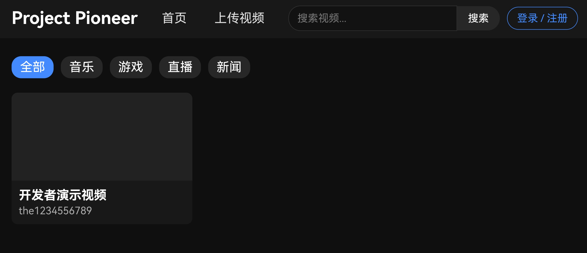

# Project Pioneer

  <a href="README.en.md">English</a> | 简体中文

## 📌 项目简介

Project Pioneer 是一款复刻 YouTube 电脑端布局的网页视频平台，采用经典左右双栏设计，内置视频播放器、评论模块，支持多语言拓展。
本项目为独立视频网站，与我的世界启动器无任何关联。

> ⚠️ **声明**：本项目仅为前端界面技术演示，仅供学习交流使用。

## 🛠 技术架构

### 网页版

- **前端框架**：原生 HTML5 + CSS3 + JavaScript
- **响应式设计**：支持现代浏览器（Chrome、Edge、Firefox 等）

### 桌面客户端

- **技术方案 A**：Electron（跨平台桌面应用框架）
- **技术方案 B**：Win32 C++ 原生开发（Windows 系统专属）

#### 桌面客户端核心模块

| 模块 | 说明 |
|------|------|
| `main.js` / `mainpro.js` | Electron 主进程，负责窗口管理、应用生命周期 |
| `main.cpp` | Win32 入口点，简单的 Windows 原生启动 |
| `mainpro.cpp` | 完整 Win32 实现，包含系统托盘、设置对话框、诊断工具 |
## 📦 安装说明
### 网页版
无需安装，直接在浏览器中访问在线站点即可：

🌐 **在线站点**：

https://the1234556789.github.io/project-pioneer/

### Windows 桌面客户端

#### 运行要求

| 配置项 | 最低要求 |
|--------|----------|
| 操作系统 | Windows 7 SP1 / Windows 10 / Windows 11 |
| 内存 | ≥ 2GB |

#### 安装步骤

1. 前往 [Releases](https://gitee.com/Wanderlust-Code/ProjectPioneer/releases) 下载最新版本
2. 运行安装程序
3. 安装程序支持 **简体中文** / **English** 两种语言
4. 安装完成后启动客户端
> ℹ️ **升级建议**：安装新版本前建议先卸载旧版本
### 桌面客户端功能特性（Win32 版本）
- **系统托盘**：支持最小化到系统托盘，托盘菜单包含显示、修复、设置、更新、关于、退出等选项
- **设置管理**：支持自定义远程 URL 配置
- **诊断工具**：内置诊断功能，检测运行环境
- **自动更新**：支持检查更新功能
## 💻 核心功能
- [x] 视频播放功能
- [x] 评论模块
- [x] 经典双栏布局
- [x] 桌面客户端（Windows）
- [ ] 多语言支持（开发中）

## 🤝 贡献指南

欢迎提交 Issue 和 Pull Request！

## 📄 版权信息

Copyright © 2024-2026 会泽工作室 All Rights Reserved
---

  Made with ❤️ by <a href="https://gitee.com/Wanderlust-Code">会泽工作室</a>

